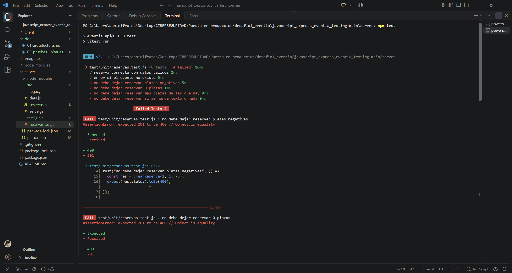

# Pruebas unitarias (Vitest)

Como todavía no se puede tocar el `server.js` y el código estaba adaptado para que corriera en Express (que es la especie de servidor web que se inicia para que podamos correr la página como una web normal en localhost), he refactorizado el código un poco para adaptarlo y que funcionara bien, pero es el mismo que hay en `server.js` con pequeñas modificaciones. Lo he sacado a tres archivos aparte (`server/src/reservas.js`, `server/src/eventos.js` y `server/src/cancelar.js`) con sus funciones (`crearReserva`, `crearEvento` y `cancelarReserva`). Así las puedo probar sueltas y llamarlas con Vitest sin tener que arrancar el servidor ni montar ningún sistema aparte ni nada por el estilo. Además, así también pruebo más partes importantes de la aplicación y no solo las reservas.

Luego he creado tres archivos dentro de `server/test/unit/` con 14 pruebas básicas en total:

1. `reservas.test.js` (6 pruebas):
- Datos normales (2 plazas en el evento 1): devuelve 201 y la crea. (Pasa)
- Evento que no existe (evento 99): devuelve 404. (Pasa)
- Plazas negativas (-3): debería dar error 400, pero devuelve 201 y la crea. (Falla)
- Reservar 0 plazas: debería dar error 400, pero devuelve 201. (Falla)
- Pedir más plazas de las que hay (100): debería dar error 400, pero devuelve 201. (Falla)
- Mandar texto ("hola") o dejarlo vacío: debería dar error 400, pero devuelve 201. (Falla)

2. `eventos.test.js` (4 pruebas):
- Crear evento con datos normales: devuelve 201 y lo crea. (Pasa)
- Crear evento sin título: debería dar error 400, pero devuelve 201. (Falla)
- Crear evento con precio negativo (-10): debería dar error 400, pero devuelve 201. (Falla)
- Crear evento con 0 plazas: debería dar error 400, pero devuelve 201. (Falla)

3. `cancelar.test.js` (4 pruebas):
- Cancelar una reserva propia: devuelve 200 y la cancela. (Pasa)
- Cancelar una reserva que no existe (999): devuelve 404. (Pasa)
- Cancelar la reserva de otro usuario: debería dar error 403, pero devuelve 200 y la cancela. (Falla)
- Cancelar dos veces la misma reserva debería dar error 400, pero devuelve 200 y vuelve a sumar las plazas. (Falla)

Al lanzar el test pasan 5 pruebas y fallan 9:

