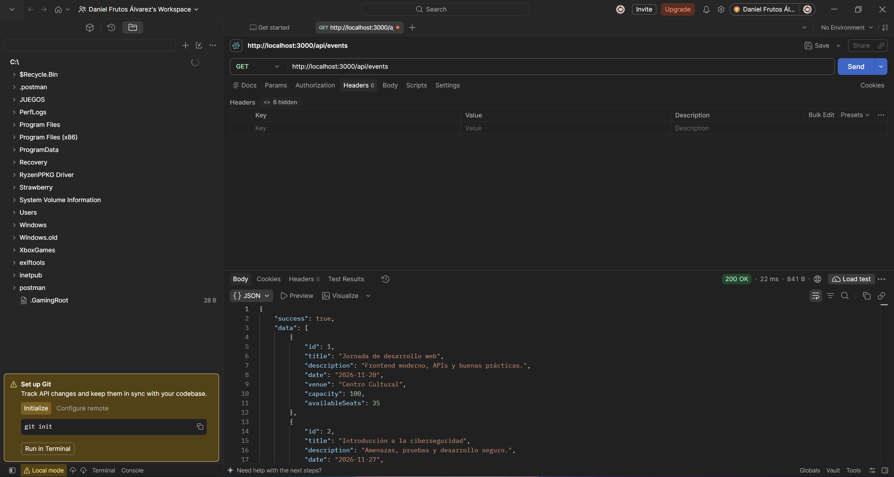
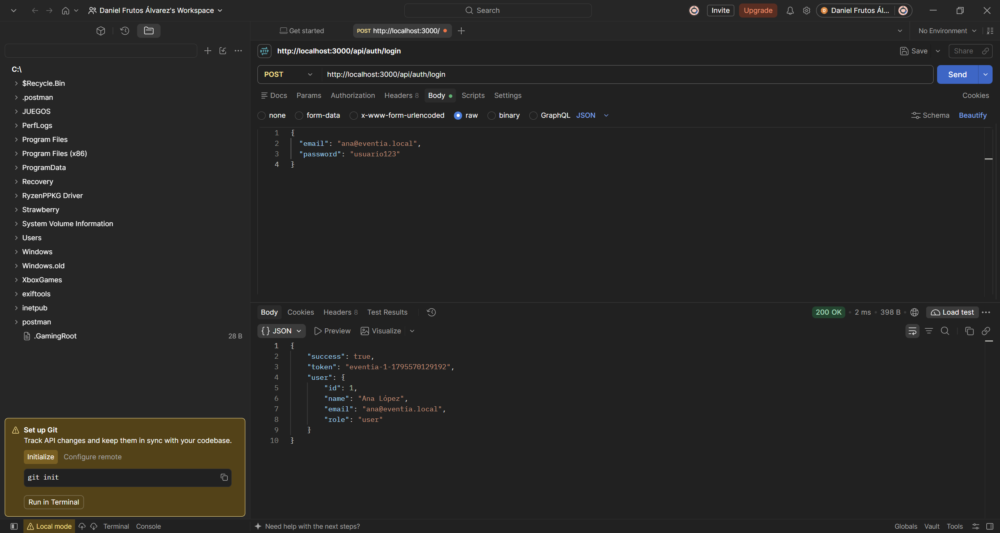
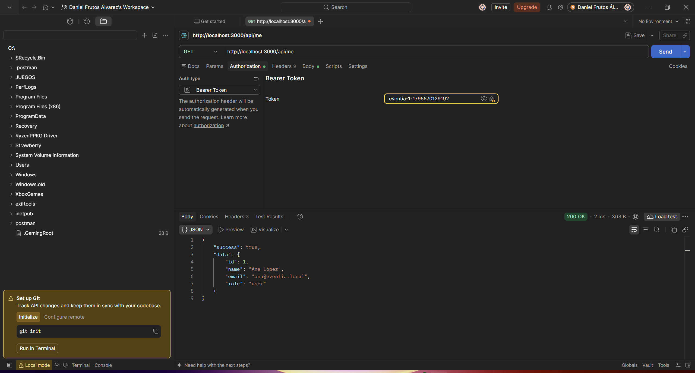
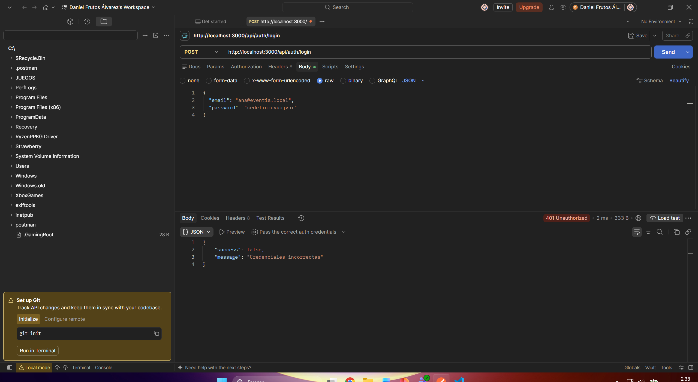
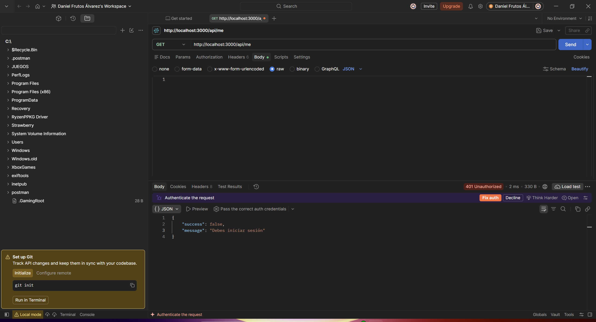
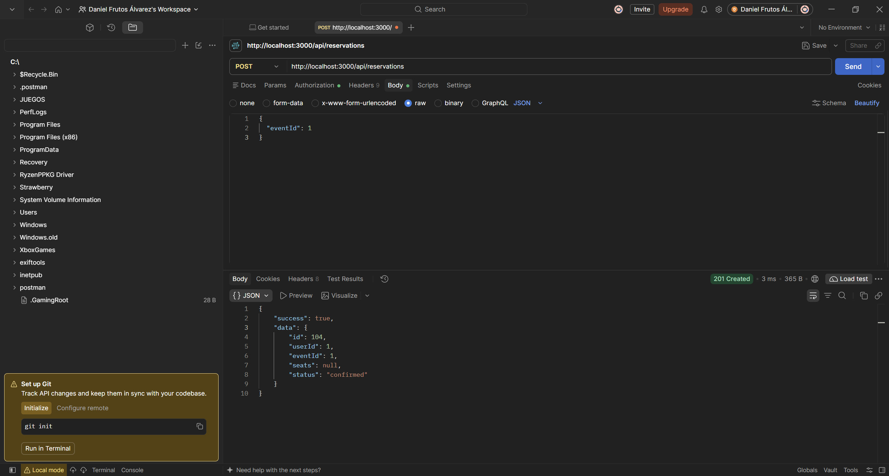
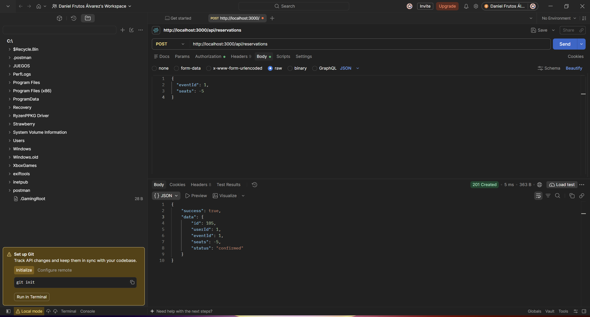
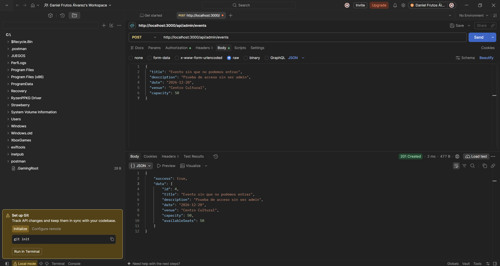
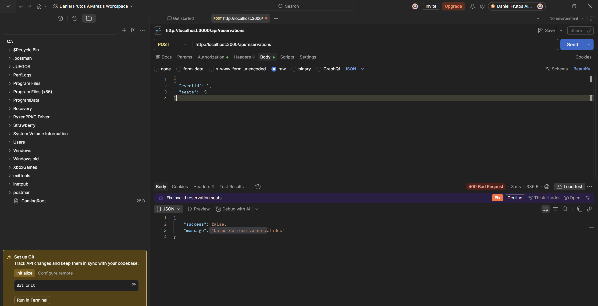
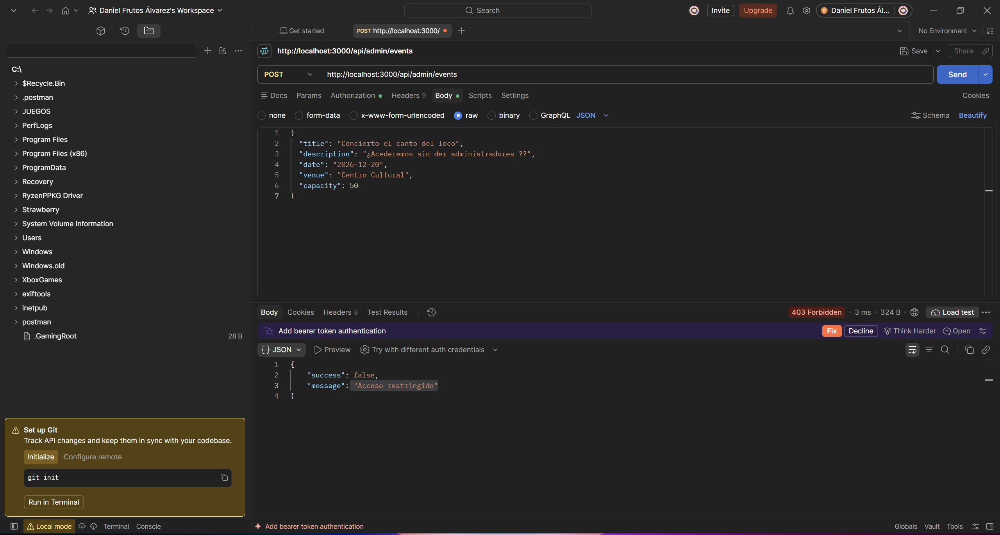

# Pruebas de API con Postman

Para probar  el comportamiento de la API , fui lanzando peticiones HTTP con Postman, como hicimos en las anteriores practicas

Antes de empezar revisé `server/src/server.js` para ver las rutas disponibles y miré en `server/src/data.js` los usuarios creados en memoria para hacer las pruebas con la cuenta normal de Ana (`ana@eventia.local`).

## Funcionamiento normal

Primero comprobé que las operaciones básicas funcionaban correctamente:

- **Obtener el listado de eventos (`GET /api/events`):** devuelve `200 OK` con el listado de los 3 eventos.

- **Iniciar sesión con credenciales correctas (`POST /api/auth/login`):** enviando el correo y contraseña de Ana en formato JSON, devuelve `200 OK` y genera el token de sesión.

- **Consultar el perfil de un usuario autenticado (`GET /api/me`):** añadiendo el token en la pestaña *Authorization* como *Bearer Token*, devuelve `200 OK` con los datos de Ana.

- **Crear una reserva válida (`POST /api/reservations`):** con el token puesto y mandando un `eventId` válido y 2 plazas, devuelve `201 Created` y guarda la reserva.

## Situaciones incorrectas y fallos detectados

Después probé a mandar datos mal hechos o intentar acciones sin permisos para ver cómo respondía la API:

- **Intentar iniciar sesión con credenciales incorrectas (`POST /api/auth/login`):** poniendo una contraseña errónea devuelve `401 Unauthorized` y bloquea el acceso correctamente.

- **Consultar información protegida sin autenticarse (`GET /api/me`):** quitando el token devuelve `401 Unauthorized` correctamente.

- **Enviar datos incompletos al crear una reserva (`POST /api/reservations`):** mandando solo el `eventId` sin indicar `seats`, el servidor no lo frenaba y devolvía `201 Created` creando una reserva incompleta.

- **Enviar valores no válidos en los campos numéricos (`POST /api/reservations`):** mandando plazas negativas (`"seats": -5`), también devolvía `201 Created` y al restar un número negativo acababa sumando plazas al evento.

- **Realizar operaciones sin permisos (`POST /api/admin/events`):** usando el token de Ana (que tiene rol `user`, no `admin`), el servidor dejaba crear un evento nuevo devolviendo `201 Created` porque no comprobaba el rol del usuario.

## Corrección en el código

Viendo estos fallos, investigué un poco cómo estaban hechas las validaciones en el resto de `server/src/server.js` para arreglarlo con condicionales if sencillos:

1. **Validación en `POST /api/reservations`:** añadí un par de `if` para comprobar que `eventId` y `seats` lleguen bien, que las plazas sean un número entero mayor que cero y que no superen las plazas libres del evento (`availableSeats`), devolviendo un `400 Bad Request` si falla algo.

2. **Comprobación de rol en `POST /api/admin/events`:** me fijé en que la ruta de abajo (`/api/admin/reservations`) ya tenía puesto un `if` comprobando `req.user.role !== "admin"`, así que añadí esa misma comprobación al principio para devolver `403 Forbidden` si el usuario no es administrador.

## Comprobación tras las modificaciones

Después de guardar los cambios, reinicié el servidor, volví a iniciar sesión con Ana para sacar un token nuevo y repetí las peticiones que antes fallaban:

- **Comprobación de reservas (`POST /api/reservations`):** al mandar datos incompletos o plazas negativas (`-5`), ahora devuelve `400 Bad Request` y no crea la reserva.

- **Comprobación de permisos de administrador (`POST /api/admin/events`):** al intentar crear el evento con el token de Ana, ahora devuelve `403 Forbidden` (`Acceso restringido`).

