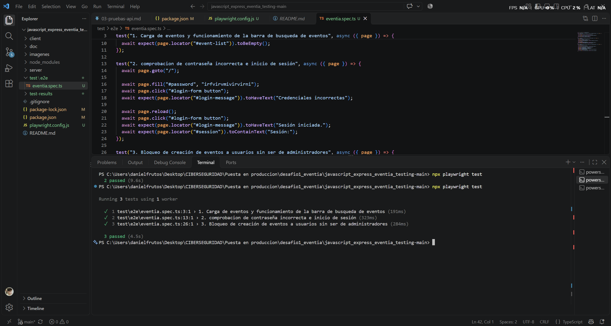

# Pruebas E2E con Playwright

En esta  fase he creado pruebas automáticas con Playwright para comprobar que toda la aplicación funciona bien de principio a fin, simulando lo que haría una persona real usando el navegador.

Para preparar las pruebas y saber cómo darle las órdenes al navegador me he ayudado de la documentación oficial de [Playwright ejemplos de localizadoress](https://playwright.dev/docs/locators) y de esta guía en español de [primeros pasos y ejemplos de uso](https://www.sngular.com/es/insights/128/playwright-primeros-pasos-y-ejemplos-de-uso).

## Revisión de la estructura de la página (HTML)

Antes de ponerme a escribir las pruebas, lo primero ha sido mirar con calma cómo está hecha la página por dentro (`client/index.html`) y cómo reacciona al pulsar botones (`client/main.js`). 

Playwright funciona como un robot al que hay que indicarle exactamente dónde tiene que hacer clic o dónde tiene que escribir. Si no sabemos bien la estructura del HTML, no sabe qué elemento elegir. Por eso revisé el código para localizar los nombres e identificadores (`id` y `name`) de las partes importantes:

* **Para escribir y buscar:** la barra del buscador (`#search`) y los campos de usuario y contraseña (`#password`).
* **Para pulsar botones:** el botón de iniciar sesión (`#login-form button`) y el de publicar un evento (`#event-form button`).
* **Para leer lo que responde la web:** la lista de eventos (`#event-list`), la barra superior donde sale quién está conectado (`#session`) y los textos de aviso (`#login-message` y `#admin-message`).

## Pruebas sencillas que he preparado

En la carpeta raíz dejé listo el archivo `playwright.config.js` para que Playwright use el navegador Chromium y arranque la aplicación antes de empezar.

Dentro de `test/e2e/eventia.spec.ts` he programado tres pruebas sencillas usando las acciones más básicas (abrir la web, escribir, hacer clic y comprobar textos):

1. **Ver que cargan los eventos y probar el buscador:** entra en la página principal, comprueba que aparece el título de la web y que se cargan los eventos con sus plazas disponibles. Después escribe en el buscador un nombre inventado y verifica que la lista se queda vacía.

2. **Comprobar que falla con clave incorrecta y entra con la buena:** escribe una contraseña inventada, pulsa en iniciar sesión y comprueba que la web avisa con `"Credenciales incorrectas"`. Luego recarga la página para volver a tener los datos por defecto, pulsa en entrar y verifica que aparece `"Sesión iniciada."` junto con los datos de sesión arriba.

3. **Comprobar que un usuario normal no puede crear eventos:** inicia sesión con el usuario normal, rellena todo el formulario de crear eventos e intenta publicarlo. Al hacerlo, comprueba que en pantalla sale `"Acceso restringido"`, verificando desde la propia web que el control de permisos que arreglé en la fase anterior funciona bien.

## Ejecución y resultados

Un detalle que he comprobado al ejecutarlo es que a veces hace falta pasar el comando dos veces. La primera vez que arranca todo desde cero, el servidor tarda un poco más en terminar de levantarse y ese pequeño retraso hace que alguna petición falle antes de tiempo. Al lanzarlo una segunda vez, con el servidor ya despierto y listo, los tres recorridos pasan sin problema.

