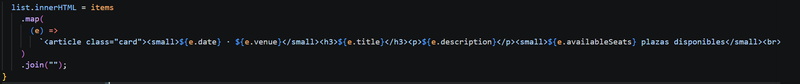
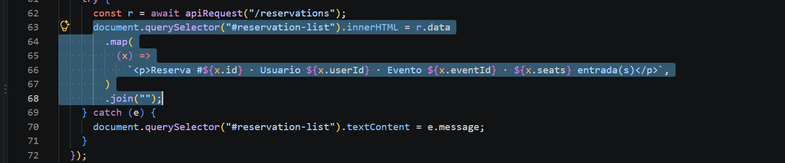
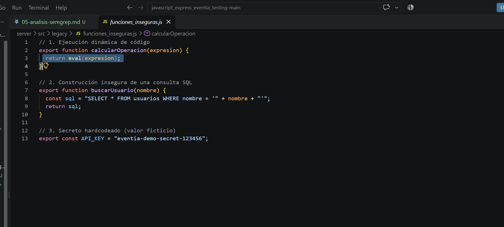
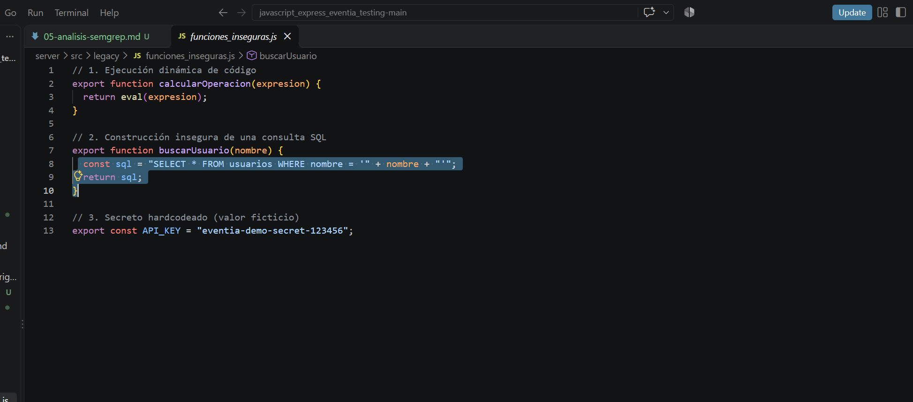
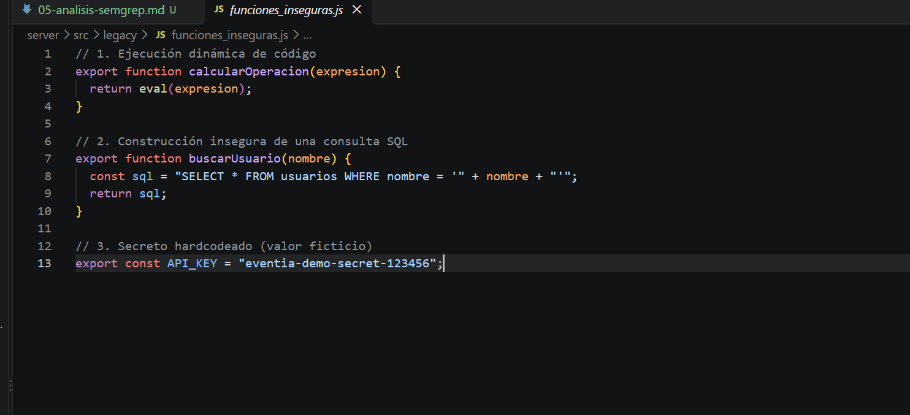

# Fase 5. Análisis estático con Semgrep

En esta última fase he revisado el código de Eventia usando **Semgrep** para buscar posibles fallos de seguridad sin tener que arrancar la aplicación ni abrir el navegador. A diferencia de un buscador normal como `grep`, Semgrep entiende el código JavaScript y sabe distinguir si algo es una orden real o un simple texto.

Para preparar el análisis desde la consola y crear las reglas en YAML me he apoyado en la [guía de inicio rápido de Semgrep](https://semgrep.dev/docs/getting-started/quickstart), en la documentación sobre [sintaxis de las reglas](https://semgrep.dev/docs/writing-rules/rule-syntax) y además en la documentación del GitHub de clase y del laboratorio que hice.

---

## 1. Entorno, reglas y ejecución

- **Versión de Semgrep:** 1.182.1
- **Sistema:** Windows con PowerShell en Visual Studio Code

Para revisar los patrones que pide el enunciado (`innerHTML`, `eval()`, consultas SQL pegadas con `+` y claves escritas en el código), creé el archivo `semgrep.yml` en la raíz del proyecto con cuatro reglas personalizadas:

```yaml
rules:
  - id: eventia-js-dangerous-eval
    pattern: eval(...)
    message: "Cuidado con eval(): coge un texto y lo ejecuta como si fuera código."
    languages: [javascript]
    severity: ERROR

  - id: eventia-js-innerhtml
    pattern: $EL.innerHTML = $VAL
    message: "Cuidado con innerHTML: si entra texto de un usuario puede colar etiquetas HTML."
    languages: [javascript]
    severity: WARNING

  - id: eventia-sql-string-concat
    pattern-regex: SELECT.*\+
    message: "Consulta SQL pegada con +: si el usuario mete comillas puede alterar la búsqueda."
    languages: [javascript]
    severity: ERROR

  - id: eventia-hardcoded-demo-key
    pattern-regex: API_KEY\s*=
    message: "Hay una clave escrita directamente dentro del archivo."
    languages: [javascript]
    severity: WARNING
```

### Resumen de los resultados obtenidos

Al comparar los dos escaneos que lancé en la terminal se ve clara la diferencia entre usar las reglas por defecto y las nuestras:

- **Escaneo automático (`semgrep scan --config auto .`):** revisó los 25 archivos del proyecto aplicando 251 reglas públicas gratuitas y **solo detectó 1 fallo** (el uso de `eval()` en `funciones_inseguras.js`). Pasó por alto los `innerHTML` del cliente, la consulta SQL concatenada y la clave escrita en el código.


- **Escaneo con reglas propias (`semgrep scan --config semgrep.yml .`):** revisó los 9 archivos `.js` con nuestras 4 reglas y **encontró los 5 avisos** (2 en `client/src/main.js` y 3 en `server/src/legacy/funciones_inseguras.js`).


Esto demuestra que apoyarse solo en el modo automático gratuito deja sin cubrir patrones peligrosos del proyecto, y que definir reglas propias en `semgrep.yml` permite localizarlos todos de una pasada. 

---

## 2. Análisis de cada hallazgo y su contexto

Que Semgrep marque una línea **no demuestra automáticamente que exista una vulnerabilidad explotable**. Por eso he revisado el contexto de cada aviso en Eventia para ver cuáles son peligros reales y cuáles corresponden a código que no se usa:

### Hallazgo 1: Uso de `innerHTML` al mostrar los eventos

1. **Archivo y línea de código:** `client/src/main.js` (línea 12).





2. **Qué hace el código:** Coge la lista de eventos que manda el servidor y mete las tarjetas directamente en la página usando `list.innerHTML = items.map(...)`.
3. **Por qué puede ser inseguro:** `innerHTML` entiende cualquier etiqueta HTML que venga dentro del texto. Como el título y la descripción los escribe una persona al crear el evento, entra texto de fuera sin limpiar.
4. **Qué consecuencias podría tener:** **Este fallo sí es explotable de verdad**, porque se ejecuta cada vez que alguien entra a la web. Si un administrador escribe un `<script>` o una etiqueta html en el título o descripción, el navegador de cualquiera que entre a la página lo ejecutará .
5. **Alternativa más segura:** Crear las etiquetas con `document.createElement` y meter los textos usando **`.textContent`**, que los muestra como texto normal sin ejecutar nada.


6. **Comprobación tras corregir:** Si cambiamos `innerHTML` por `textContent` en `client/src/main.js` y volvemos a lanzar `semgrep scan --config semgrep.yml .`, desaparece el aviso de la línea 12.


### Hallazgo 2: Uso de `innerHTML` al mostrar las reservas
1. **Archivo y línea de código:** `client/src/main.js` (línea 63).





2. **Qué hace el código:** Pinta en pantalla la lista de reservas del usuario (`id`, `userId`, `eventId` y `seats`) usando `.innerHTML`.
3. **Por qué puede ser inseguro:** Usa la misma forma de meter HTML directo en la página.
4. **Qué consecuencias podría tener (contexto en Eventia):** Ahora mismo **no se puede explotar**, porque ahí solo se pintan números generados por el servidor y ningún texto escrito por usuarios. Aun así, si en el futuro se añade algún campo de texto libre sería un problema.

5. **Alternativa más segura:** Cambiarlo también por etiquetas creadas con `document.createElement("p")` y `.textContent`.


6. **Comprobación tras corregir:** Al hacer el cambio y pasar otra vez Semgrep, `client/src/main.js` ya no da ningún aviso.


### Hallazgo 3: Uso de `eval()` para ejecutar texto
1. **Archivo y línea de código:** `server/src/legacy/funciones_inseguras.js` (línea 3).




2. **Qué hace el código:** La función `calcularOperacion(expresion)` recibe un texto y lo ejecuta directamente con `return eval(expresion);`.

3. **Por qué puede ser inseguro:** `eval()` coge cualquier texto y lo ejecuta como si fuera una orden real dentro del servidor.
4. **Qué consecuencias podría tener :** En una web activa permitiría ejecutar órdenes maliciosas en el servidor. Sin embargo, tras buscar en todo el proyecto he visto que ningún archivo de la web llama ni usa `funciones_inseguras.js` está suelto en la carpeta `legacy/` , así que **no es explotable**.
5. **Alternativa más segura:** Borrar el archivo al no utilizarse o comprobar que solo entren números sin usar `eval()`.


6. **Comprobación tras corregir:** Si borramos el archivo o quitamos `eval()` y volvemos a pasar `semgrep scan --config semgrep.yml .`, la alerta desaparece.


### Hallazgo 4: Consulta SQL pegando texto con `+`
1. **Archivo y línea de código:** `server/src/legacy/funciones_inseguras.js` (línea 8).




2. **Qué hace el código:** La función `buscarUsuario(nombre)` monta una búsqueda en base de datos uniendo texto con `+`: `"SELECT * FROM usuarios WHERE nombre = '" + nombre + "'"`.
3. **Por qué puede ser inseguro:** Mezcla la orden de búsqueda con lo que escribe el usuario.
4. **Qué consecuencias podría tener: Permitiría hacer inyección SQL (`' OR '1'='1`) para ver datos privados o saltarse filtros, pero en Eventia no es explotable** porque este archivo no se usa en ningún sitio como hemos dicho anteriormente y la aplicación ni siquiera tiene una base de datos SQL guarda todo enmemoria.
5. **Alternativa más segura:** Usar consultas parametrizadas (`SELECT * FROM usuarios WHERE nombre = ?`) para separar la orden del dato que escribe el usuario.
6. **Comprobación tras corregir:** Al cambiarlo por una consulta parametrizada o borrar el fichero y lanzar de nuevo Semgrep, deja de saltar la regla `eventia-sql-string-concat`.


### Hallazgo 5: Clave escrita directamente en el código
1. **Archivo y línea de código:** `server/src/legacy/funciones_inseguras.js` (línea 13).





2. **Qué hace el código:** Deja una clave escrita a la vista en el archivo: `export const API_KEY = "eventia-demo-secret-123456";`.

3. **Por qué puede ser inseguro:** Cualquiera que entre al repositorio de GitHub puede leer esa clave directamente.

4. **Qué consecuencias podría tener :** Si fuera una clave real alguien podría copiarla y usarla haciéndose pasar por la aplicación. En este caso no tiene impacto real porque es una clave de ejemplo dentro de un archivo que no se usa, pero no hat que dejar contraseñas en el código.

5. **Alternativa más segura:** Sacar la clave a un archivo `.env` (ignorado en `.gitignore` para que no suba a GitHub) y leerla con `process.env.API_KEY`.


6. **Comprobación tras corregir:** Al quitar el texto fijo y volver a pasar `semgrep scan --config semgrep.yml .`, el resultado final baja a `0 findings`.

---

## 3. Conclusión

El resultado de Semgrep sirve para detectar rápido descuidos en el código parado, pero **no demuestra automáticamente que exista una vulnerabilidad explotable, igual que tener 0 alertas no garantiza que la web sea segura**. Como hemos visto al revisar el contexto, los tres fallos del servidor están aislados en `legacy/` sin usarse, mientras que el `innerHTML` de los eventos sí es un riesgo real. Además, Semgrep no ve fallos de permisos en las rutas (como pasaba al crear eventos sin ser administrador), por lo que siempre hay que combinarlo con pruebas unitarias, de API y de navegador.