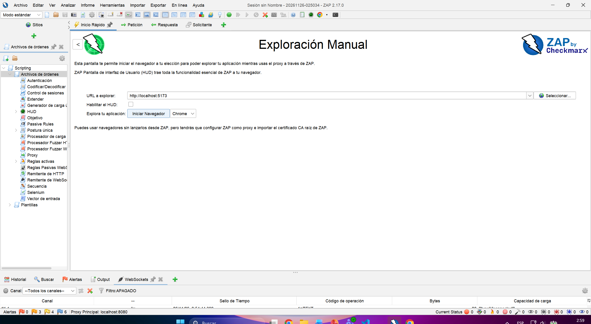
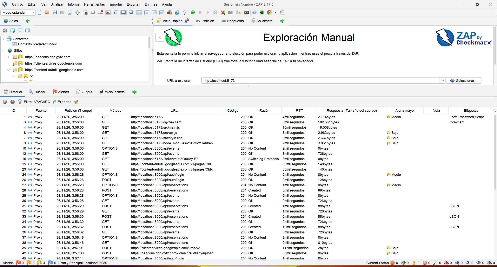
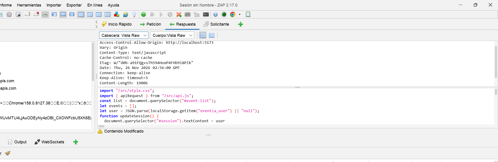
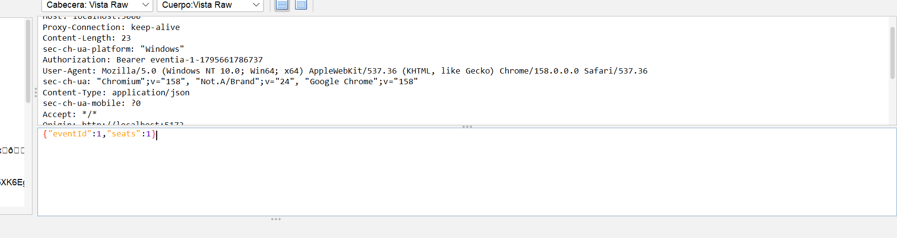
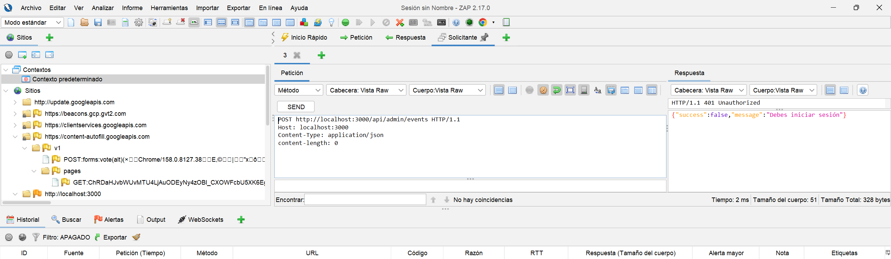
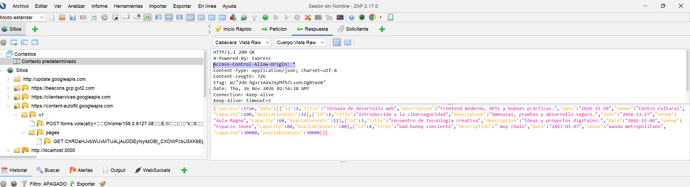
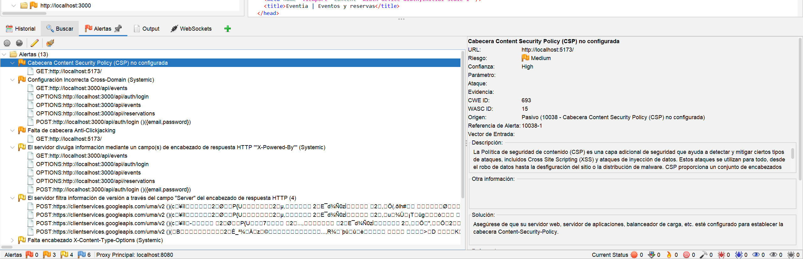
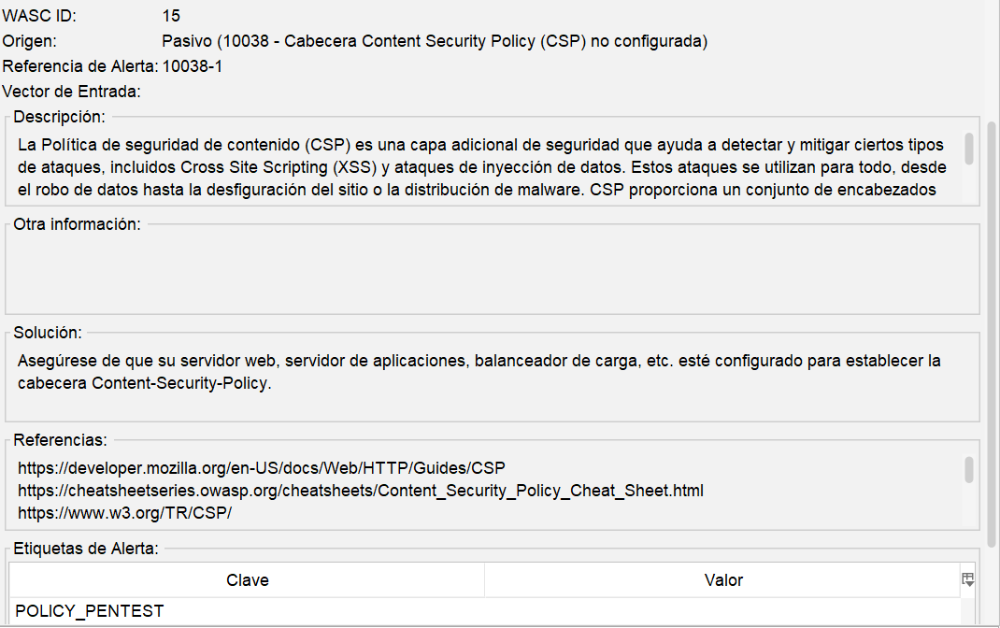

Fase 6: Análisis dinámico con OWASP ZAP

## 1. Configuración del proxy y recorrido por la aplicación

- **Cómo se ha configurado:** he arrancado el servidor y el cliente en local, y se ha abierto el navegador integrado de OWASP ZAP (*Manual Explore*) para interceptar el tráfico HTTP.

- **Acciones realizadas:** He hecho una consulta de eventos públicos, he iniciado sesión como usuario normal (`ana@eventia.local`), reserva de plaza, consulta de reservas y creación de un evento como administrador. Como podemos ver:

**Revisión visual de las peticiones:**
Como podemos apreciar, ya la aplicación está encontrando vulnerabilidades; las identifica con banderas de distintos colores para expresar alertas, para que revisemos el funcionamiento y arreglemos estos fallos para que no salgan y no puedan encontrar problemas en nuestro sistema.

---

## 2. Revisión de las peticiones HTTP

Al entrar en el historial de ZAP y mirar lo que manda el navegador y lo que responde el servidor, he podido ver cómo viajan los datos por dentro:

- **Tipos de peticiones:** La web usa peticiones `GET` para pedir información (como ver la lista de eventos o mis reservas) y peticiones `POST` para enviar datos nuevos (iniciar sesión, reservar una plaza o crear un evento). También salen peticiones `OPTIONS` que lanza el navegador automáticamente antes de hablar con el servidor.

- **Qué datos viajan en cada paso:**
  - Al cargar los eventos (`GET /api/events`), los datos van en abierto porque es información pública y no hace falta iniciar sesión.
  - Al iniciar sesión (`POST /api/auth/login`), he visto que tanto el correo como la contraseña se leen en texto normal dentro de la petición, ya que en local estamos trabajando sin cifrado (HTTP). Cuando los datos son correctos, el servidor responde entregando los datos del usuario junto con una llave de acceso (`token`) para identificar la sesión.
  - En las acciones privadas (como reservar una entrada), el navegador incluye ese `token` en la petición para demostrar que ya tiene la sesión abierta.

---

## 3. Quién entra, qué permisos tiene y pruebas cambiando peticiones

En este punto he comprobado cómo controla el servidor a los usuarios:

- **Diferencia entre entrar y tener permiso:**
  - **Autenticación** es demostrar quién soy al poner mi correo y contraseña para entrar.
  - **Autorización** es comprobar qué me deja hacer mi cuenta según el tipo de usuario que sea (un usuario normal solo puede reservar plazas; el administrador puede crear eventos nuevos).

- **Prueba enviando una orden sin tener permiso:** Usando la herramienta **Solicitante** de ZAP, he enviado a mano la orden de crear un evento (`POST /api/admin/events`) sin haber iniciado sesión. El servidor me ha frenado al momento con el mensaje **`"Debes iniciar sesión"`** (`401 Unauthorized`). Esto demuestra que el servidor comprueba los permisos de verdad y no se deja engañar aunque no usemos los botones de la web.

---

## 4. Permisos entre webs, protecciones del navegador y guardado de la sesión

Al mirar las respuestas del servidor he visto tres cosas que están pensadas solo para trabajar en nuestro ordenador de pruebas:

- **Puerta abierta a otras webs (CORS):** El servidor responde con `Access-Control-Allow-Origin: *`. Esto significa que deja que cualquier página web de fuera le pida datos. Para hacer pruebas en local viene bien, pero si subiéramos Eventia a Internet habría que cerrarlo para que solo acepte peticiones desde nuestra propia página.
- **Faltan protecciones extra en el navegador:** El servidor no envía reglas de seguridad adicionales para proteger la pantalla (por ejemplo, para evitar que otra página meta nuestra web dentro de un marco falso para engañar a la gente).
- **Dónde se guarda tu sesión:** Al iniciar sesión, la web guarda la llave de acceso es decir el token en una memoria abierta del navegador (`localStorage`). Si alguien consiguiera colar un código malicioso en la página (como vimos en la fase anterior), podría leer esa llave y robarte la cuenta. En una web real habría que guardarla en una cookie cerrada a la que ningún código pueda acceder.

---

## 5. Avisos y banderas de OWASP ZAP

Si entramos en la pestaña **Alertas** (las banderas de colores de abajo de las que he hablado al inicio), ZAP nos avisa de varios fallos normales por estar trabajando en local y no en Internet. Además, si pinchamos encima de cada bandera, el propio programa nos da información detallada sobre qué es ese fallo y nos indica qué partes tenemos que analizar y reestructurar en la aplicación para poder arreglarlo:

- **Faltan reglas de protección en el navegador:** Las banderas naranjas y amarillas avisan de que el servidor no manda cabeceras de seguridad para blindar la página frente a códigos raros o webs falsas.

---

## 6. Conclusiones

Con estas pruebas he visto que Eventia protege bien lo más importante: obliga a iniciar sesión para las acciones privadas y no deja crear eventos si no eres administrador. Eso sí, como está preparada para hacer pruebas en local, antes de sacarla a Internet habría que ponerle cifrado HTTPS, añadir las protecciones del navegador que pide ZAP, cerrar el acceso a webs externas y guardar la sesión en un sitio más seguro.