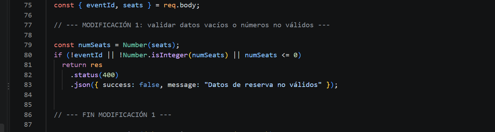

# Fase 7: Corrección y verificación

En esta última parte del proyecto recojo los arreglos que ya fui metiendo en el servidor (`server.js`) durante la fase de pruebas de la API, cuando empecé a lanzar peticiones con Postman y vi los primeros fallos. También dejo apuntados otros problemas que tiene la web y que habría que solucionar más adelante.

Como mi perfil es de sistemas  no sé mucho de programación web, he preferido limitar mis cambios en el código a las validaciones de datos y permisos dentro de `server.js`, que son comprobaciones sencillas que entiendo bien. Los demás fallos, que obligan a cambiar cómo se pinta la pantalla o cómo está montada la aplicación por dentro, los dejo explicados al final para no arriesgarme a tocar código que no domino y que la web deje de funcionar.

---

## 1. Arreglos hechos en `server.js` durante las pruebas de API

### Validación del número de plazas (`POST /api/reservations`)

Al principio el servidor no revisaba bien el número de entradas (`seats`) que se pedían, así que aceptaba cantidades negativas, ceros o campos vacíos. Para evitarlo, en la fase de pruebas de API añadí la **Modificación 1** en `server.js`, comprobando que el evento exista y que las plazas sean un número entero mayor que cero (`Number.isInteger(numSeats) && numSeats > 0`).

Con este cambio evitamos que alguien manipule la petición para mandar `-2` entradas y sumar plazas falsas al evento, o que meta datos raros que líen las cuentas. Como ya comprobé en Postman al enviar `seats: -2`, el servidor ahora corta la reserva y devuelve un error `400 Bad Request` con el aviso `"Datos de reserva no válidos"`.

---

### Control de plazas libres disponibles (`POST /api/reservations`)

Otro fallo que vi al probar las reservas es que el servidor restaba las entradas directamente sin mirar si quedaban suficientes sitios libres en ese evento. Por eso añadí la **Modificación 2**, poniendo un `if (numSeats > e.availableSeats)` para frenar la operación si alguien pide más entradas de las que hay disponibles.

De esta forma nos aseguramos de que no se reserven más plazas de las que caben en el sitio y de que el contador de aforo nunca acabe en números negativos. Al intentar pedir más entradas de las libres desde Postman, el servidor rechaza la petición con un `400 Bad Request` (`"No hay suficientes plazas disponibles"`).

---

### Bloqueo de creación de eventos a usuarios normales (`POST /api/admin/events`)

Para dar de alta un evento nuevo, el servidor solo pedía haber iniciado sesión (`requireLogin`), pero no miraba si la cuenta tenía permisos de administrador o era de un usuario normal. En la **Modificación 3** añadí la comprobación `if (req.user.role !== "admin")` para cortar el paso a cualquiera que no sea administrador.

Así evitamos que un usuario corriente pueda publicar eventos saltándose los botones de la pantalla y mandando la petición directamente a la API. Al probarlo desde Postman con la cuenta normal de Ana (`ana@eventia.local`), el servidor ya bloquea el intento devolviendo un `403 Forbidden` (`"Acceso restringido"`).

---

## 2. Otros fallos detectados en la web (pendientes de corregir)

Además de estos tres arreglos en el servidor, durante el resto de fases han salido otros problemas que requerirían cambios más profundos de programación:

- **Inyección de código en la pantalla / XSS (`client/src/main.js`):** La página usa `.innerHTML` para pintar los eventos y las reservas. Si alguien escribe etiquetas HTML o JavaScript en el título o en la descripción de un evento, el navegador las ejecuta en lugar de mostrarlas como texto. Habría que cambiar `.innerHTML` por `.textContent` al crear los elementos en pantalla para que se vean como texto normal.

- **Ver o borrar reservas de otros usuarios / IDOR (`server.js`):** En las rutas de consultar o borrar reservas (`/api/reservations` y `/api/reservations/:id`), el servidor comprueba que hayas iniciado sesión, pero no mira si esa reserva es realmente tuya (`r.userId === req.user.id`). Habría que filtrar el listado para enseñar solo las reservas del usuario conectado y devolver un error `403` si alguien intenta abrir o borrar la reserva de otra persona.

- **Permisos abiertos entre webs y cabeceras HTTP (`server.js`):** El servidor tiene `cors()` abierto a todo el mundo (`*`) y no manda cabeceras básicas de protección al navegador como `X-Frame-Options` o `X-Content-Type-Options`. Lo suyo sería cerrar `cors()` para aceptar peticiones solo desde nuestra página (`http://localhost:5173`) y añadir esas cabeceras en las respuestas.

- **Guardar la sesión y cifrar el tráfico (`client/src/main.js`):** El token de sesión se guarda en `localStorage` y en local todo va por HTTP sin cifrar. Si esta web se subiera a Internet, habría que ponerle HTTPS y guardar la sesión en cookies seguras (`HttpOnly` y `Secure`) para que ningún script pueda leer el token.